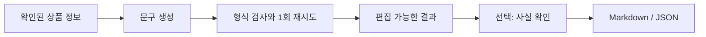

# Commerce Content Engine
확인된 상품 정보로 상세페이지부터 광고 문구까지 한 번에 만드세요.

- 상세페이지·FAQ·광고 문구·해시태그·쇼츠 대본·썸네일 문구를 만듭니다.
- 사실 확인으로 근거를 살피고, 토너먼트로 짧은 광고를 비교합니다.
- Markdown·JSON으로 저장하고, 직접 입력한 가격과 비용으로 마진을 계산합니다.

[네모트론 데모 체험](https://commerce-content-engine-nemotron.vercel.app) · [내 API 키로 사용](https://kks0488.github.io/commerce-content-engine/) · [English](README.md)

빠른 시작 (Node 18 이상, 별도 설치 없음):

```sh
npm test
node cli.mjs --demo
NEBIUS_API_KEY="$NEBIUS_API_KEY" node cli.mjs --provider nebius --name "스테인리스 컵" --info "용량 500ml; 스테인리스; 분리형 뚜껑; 손세척" --lang Korean
```

실제 생성은 환경변수 `NEBIUS_API_KEY`를 설정하세요. 호환 서비스는 `LLM_API_KEY`, `LLM_BASE_URL`, `LLM_MODEL`로 연결합니다. `--demo`는 오프라인 고정 예시입니다. 호스팅용 브랜치에서 `node scripts/serve.mjs`로 웹 화면을 실행합니다. GitHub Pages에서는 브라우저가 선택한 AI 서비스로 내 키를 직접 전송합니다.



**Nebius에서 사용하는 Nemotron**

- Lightning이 엄격한 JSON 형식으로 초안을 씁니다. 추론은 끄고, 형식이나 문구 검사에 실패하면 Super로 한 번 수정합니다. 답변이 비어 있는 FAQ는 제공된 사양으로 채웁니다.
- 호스팅용 브랜치에서는 Super가 주장과 근거를 비교하고, 토너먼트는 사실 검사를 통과한 광고를 가상 구매자 관점으로 비교합니다.
- 해커톤에서 CLI·웹 편집기·사실 확인·토너먼트·공개 데모·실제 응답 회귀 검사를 만들었습니다. AI는 판매자가 준 정보를 바탕으로 검토하며, 게시 전 사람이 확인해야 합니다.

MIT © 2026 Kyoungsoo Kim. [LICENSE](LICENSE) 참고.
