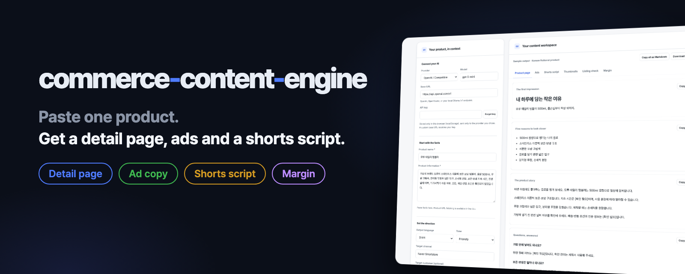
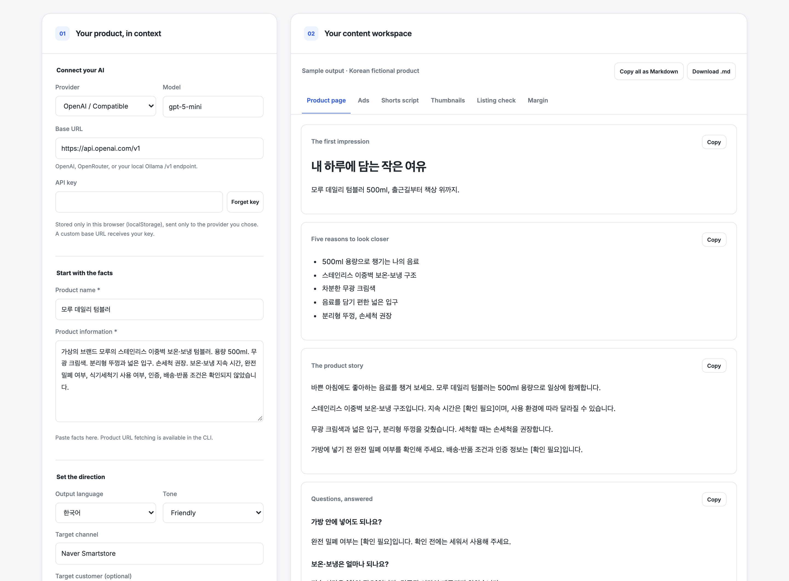
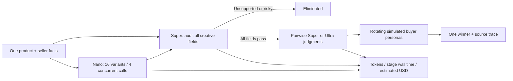
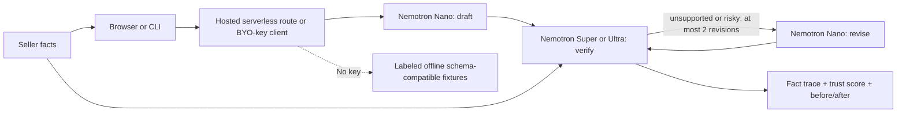
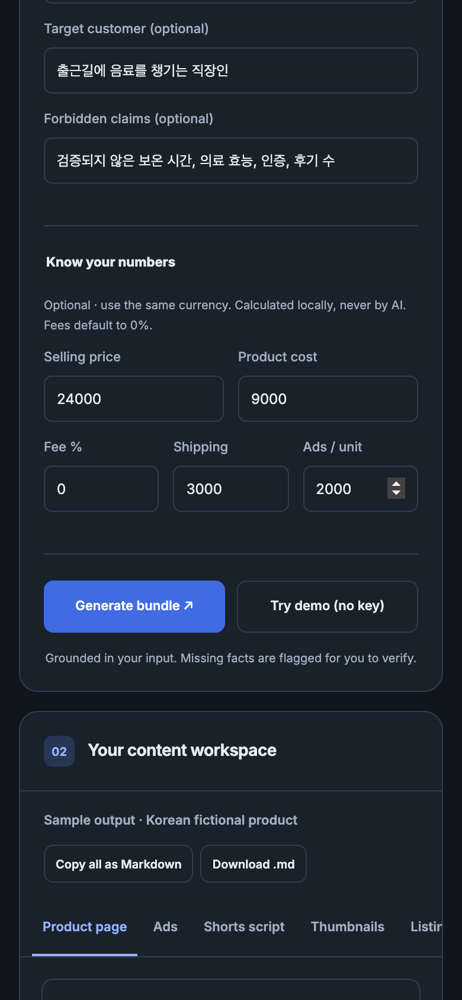

> **Nebius hackathon branch — Fact Guard v2:** 16 parallel creative ideas, an evidence gate, and one persona-judged winner, powered by Nemotron on Nebius Token Factory. [Hosted demo](https://commerce-content-engine-nemotron.vercel.app/) · [Hackathon source branch](https://github.com/kks0488/commerce-content-engine/tree/nebius-nemotron) · [MIT license](LICENSE).
>
> **Current status:** the hosted demo uses clearly labeled offline fixtures until `NEBIUS_API_KEY` is configured. No live Nebius inference has been verified. Real screen captures are in [media/](media/); the public YouTube demo is pending owner publication.

<p align="center"></p>

<p align="center">
  <a href="https://github.com/kks0488/commerce-content-engine/actions/workflows/ci.yml"></a>
  <a href="#license"></a>
  
  =18">
  <a href="https://kks0488.github.io/commerce-content-engine/"></a>
</p>

<p align="center"><strong>English</strong> · <a href="README.ko.md">한국어</a></p>

<h2 align="center"><strong>Paste one product. Get a detail page, ad copy, a shorts script and thumbnail text in one run.</strong></h2>

For online sellers, small brands, marketers and agencies: bring your own AI key and turn product facts into copy you can review and use. The original GitHub Pages app runs in your browser and sends requests directly to your chosen AI provider. The separate hosted Fact Guard demo sends product facts to a serverless route that holds its inference key; it does not persist product inputs or outputs.

<p align="center"></p>

<table>
  <tr>
    <td width="50%"><strong>Detail page</strong><br>Headline, subheadline, five key points, product story and FAQ. Copy for your page, ready to review.</td>
    <td width="50%"><strong>Ads + shorts script</strong><br>Ad headlines, primary text and keywords, plus a 30–45 second script with timed scenes, visuals, voiceover, captions and a call to action.</td>
  </tr>
  <tr>
    <td><strong>Thumbnail text + listing check</strong><br>Short text options with creative angles, alongside prioritized issues and suggested fixes for your listing.</td>
    <td><strong>Margin snapshot</strong><br>Unit profit, margin and break-even ROAS computed locally in plain JavaScript, not by AI. Enter your price, cost, fees, shipping and ad spend per unit.</td>
  </tr>
</table>

## Variant Tournament / Fact Guard v2

**[Open the tournament demo](https://commerce-content-engine-nemotron.vercel.app/?tournament)** · [Original Fact Guard](https://commerce-content-engine-nemotron.vercel.app/?fact-guard)

Sellers need several creative directions, but generating and manually fact-checking each one is slow. One product now becomes **16 ad variants by default, up to 32**: Nano explores different angles, tones and audiences through a pool of four parallel requests. Each creative includes a headline, hook and exactly three contiguous beats spanning 0–3, 3–10 and 10–15 seconds, with visuals, voiceover and captions. Super independently reviews every displayed text field. Missing, contradictory, unsupported, risky or uncited factual copy is eliminated before judging. There must be at least one supported factual field to qualify.

Verified survivors enter pairwise Super judgments (or Ultra via `NEBIUS_JUDGE_MODEL`). Practical, design-focused, skeptical and busy-mobile buyer personas rotate across duels. Odd fields advance through explicit byes; zero survivors means **no winner**. Reasons are visible throughout, and the winner retains every source quote and its full 15-second script. These personas simulate preferences; they are not customer research or conversion predictions.



The animated 4×4 field streams actual server progress over NDJSON, shows eliminations and bracket rounds, and supports tile inspection, replay, 32-tile fields, mobile layouts and reduced motion. On the hosted Nemotron domain it is the default landing page; the original bundle/Fact Guard interface remains at `?fact-guard`. On a static host the tournament explicitly uses offline fixtures.

**Honest accounting:** every stage reports calls, token usage, stage wall time and estimated USD. Parallel calls reduce waiting, not billed tokens. Prices come from the [official public model catalogue](https://tokenfactory.nebius.com/api/public/models_info), checked with curl on 2026-10-16: Nano $0.06/$0.24, Super $0.30/$0.90, Ultra $1/$3 per million input/output tokens. The optional all-large comparison holds token counts constant and reprices only generation at the judge model's rate. It is a counterfactual cost estimate, not a measured performance benchmark. Unknown model prices or missing usage show as unavailable. Fixture tokens are estimated; fixture times measure local replay, and the animation is deliberately paced. No live inference or sponsor speed/cost benchmark has been verified.

**Hosted bounds:** `POST /api/tournament` accepts product fields plus integer `count` (2–32). Server configuration controls model names, credentials, endpoints, a four-request pool, two active tournaments per warm instance, five runs per trusted IP per ten minutes, 16 KB bodies, 64 source facts and a 280-second deadline. Browser disconnects cancel in-flight model calls. Limits are in-memory **per instance**, not a distributed quota: cold starts or horizontal scaling can exceed aggregate limits. No paid storage or rate-limit service was provisioned. Live upstream/schema failures stop the run and never fall back to demo fixtures.

**Offline behavior:** the sample deliberately injects four unsafe variants into the default field; 12 survive and require 11 judged duels. Responses use the official [Chat Completion envelope and usage schema](https://docs.tokenfactory.nebius.com/api-reference/inference/create-chat-completion), read using curl. Offline templates are English, judgments are scripted, and arbitrary custom forbidden claims fail closed because template fixtures cannot verify them.

```sh
# On pilot for dev servers/builds/browser recording; small node tests can run locally.
node --test
# No dependencies needed.
npm run dev
# http://127.0.0.1:8080/?tournament
npm run build
# Live mode activates automatically when NEBIUS_API_KEY or LLM_API_KEY exists.
# Optional: NEBIUS_JUDGE_MODEL=nvidia/Nemotron-3-Ultra-550b-a55b
# PLAYWRIGHT_MODULE and PLAYWRIGHT_CHROMIUM_PATH can select installed tools on pilot.
node scripts/capture.mjs
```

Core: [`src/tournament.js`](src/tournament.js). Hosted endpoint: [`api/tournament.js`](api/tournament.js), reusing the existing input/rate-limit handler. UI: [`tournament.js`](tournament.js), `index.html`, `styles.css`. Mocked-model/API tests: [`test/tournament.test.mjs`](test/tournament.test.mjs). Real 1920×1080 screenshots: [`media/06-tournament-ready.png`](media/06-tournament-ready.png) through [`media/10-tournament-winner-trace.png`](media/10-tournament-winner-trace.png); mobile screenshot: [`media/11-mobile-tournament.png`](media/11-mobile-tournament.png). The captured `media/tournament-1920x1080.webm` is intentionally uncommitted and also copied into the owner's `hackathons/nebius/capture/` folder for the shared video kit.

## Nemotron on Nebius Token Factory

**Problem:** invented specifications, certifications and performance promises can lead to returns and rejected listings. Sellers need to see which supplied fact supports each line of generated copy.

**Solution:** Fact Guard turns a seller's facts into a complete commerce bundle, independently audits every text field, revises unsupported or risky statements, then audits the revised bundle. It keeps the draft, final copy, verification history and exact source quotes visible. The score is the percentage of reviewed factual fields with valid citations; creative text and instructions are excluded. It measures an AI assessment against seller input, not objective truth or legal compliance. A compound field must have all its assertions supported. Missing reviews, duplicate paths, mismatched copy, absent citations and invented quotes fail closed.

The model IDs below were verified against the [official public catalogue](https://tokenfactory.nebius.com/api/public/models_info) on October 16, 2026:

| Role | Exact model ID | Routing rationale |
| --- | --- | --- |
| Draft + revise | `nvidia/NVIDIA-Nemotron-3-Nano-30B-A3B` | Smaller model handles content generation and targeted revisions |
| Verify (default) | `nvidia/nemotron-3-super-120b-a12b` | Larger reasoning model checks all assertions and citations |
| Verify (optional) | `nvidia/Nemotron-3-Ultra-550b-a55b` | Available through CLI/BYO-key verifier selector or server configuration |

All requests use the OpenAI-compatible `https://api.tokenfactory.nebius.com/v1/chat/completions` endpoint and bearer authentication, as documented in the [quickstart](https://docs.tokenfactory.nebius.com/quickstart). [Public endpoints route globally](https://docs.tokenfactory.nebius.com/public-serverless); no fixed region is assumed. The implementation uses JSON instructions and validates/parses responses rather than assuming that every model supports constrained JSON mode.



Each step records the actual response model, wall-clock latency and provider-reported token usage. No price/savings benchmark is claimed: routing counts are visible so judges can assess the approach. Offline replay uses documented [Chat Completion envelopes](https://docs.tokenfactory.nebius.com/api-reference/inference/create-chat-completion) with **estimated** token counts and local replay times; these are not inference measurements. The demonstration intentionally injects one unsupported heat-retention claim and one risky medical claim, then removes them. It is not evidence that a real model produced or detected these errors. Offline copy is English template text (seller facts remain as entered); chosen output languages are honored by live prompts.

### Run Fact Guard

No packages need installing. Use Node.js 18+ (Node 22 recommended).

```sh
# Offline CLI fixture: full bundle plus factGuard metadata
node cli.mjs --fact-guard --demo --format json

# Offline or live browser + same serverless handler
npm run dev
# Open http://localhost:8080/?fact-guard

# Live mode: set NEBIUS_API_KEY in your shell, then restart npm run dev.
# Obtain the key yourself; .env.example lists empty configuration fields.
# The app intentionally does not automatically load .env files.
node cli.mjs --fact-guard --name "Everyday Steel Cup" \
  --info "Capacity: 500 ml. Material: stainless steel. Hand wash recommended." \
  --lang en --format json

# Optional larger verifier
node cli.mjs --fact-guard --verifier ultra --file examples/sample-product.json

npm test
npm run build
```

`NEBIUS_API_KEY` automatically enables live mode in the hosted endpoint and Fact Guard CLI. An invalid key or failed live call returns an error; it never silently switches to fixtures. `--demo` explicitly forces fixtures. Generic `LLM_BASE_URL`, `LLM_API_KEY`, `LLM_MODEL` support an OpenAI-compatible alternative; that alternative does not by itself satisfy the Nebius hackathon runtime requirement. `NEBIUS_DRAFT_MODEL` and `NEBIUS_VERIFY_MODEL` override hosted routing. On static GitHub Pages, select **Nebius Token Factory / Nemotron** and enable **Fact Guard** to use your own key directly. Plain single-model generation also supports the `nebius` provider.

### Separate hosted project

The project is `commerce-content-engine-nemotron`; the original Pages deployment is unaffected. The Vercel build copies only public files into `out/`; the serverless function imports the shared core. Deploy from this branch:

```sh
vercel link --yes --project commerce-content-engine-nemotron
vercel --prod --yes
```

Add `NEBIUS_API_KEY` through the Vercel environment-variable UI (Production), then redeploy. Keys stay in the function environment and never reach the browser. `GET /api/fact-guard` reports only mode and model names. `POST` accepts product fields only; users cannot override keys, models, upstream URLs or round limits. Bounds: 16 KB JSON, 160-character name, 8,000-character facts, 64 fact segments, five runs per IP per ten minutes, two revisions and a 280-second total pipeline budget. Request timeouts bound live work. Rate limiting is **in-memory per warm function instance**, so cold starts/multiple instances reset it; use a distributed quota before opening sustained paid traffic. No usage-based add-ons or paid services are provisioned.

### What was built during the hackathon

This is an extension of the existing MIT Commerce Content Engine, not a claim that the original app was created during this hackathon. The existing baseline supplied the dependency-free browser, CLI, bundle schema, margin calculation and CI. The `nebius-nemotron` branch adds the Nebius provider; Nano → Super/Ultra → Nano agent orchestration; complete field coverage and verbatim source validation; trust scoring, history, before/after and step metrics; deterministic offline API-schema fixtures; the serverless endpoint and limits; separate Vercel configuration; focused tests and real Playwright screen captures. Fact Guard v2 adds parallel variant generation, fail-closed elimination, persona brackets, streamed arena animation, per-stage cost estimates, hosted concurrency bounds, mocked tournament/API tests and 1080p screen/video captures. Main is not merged.

### Submission readiness and sponsor feedback

Track: **Best Apps and Agents**. The [official rules](https://nebiusglobalaihackathon.devpost.com/rules) permit existing projects with significant in-period updates and a written explanation. Deadline: **October 30, 2026, 10:00 PDT**. Tracks are Coding and Agentic Engineering, Best Apps and Agents, Personal AI, and Physical AI. Required submission items: working Nebius/NVIDIA project, chosen track, English description, working demo URL, public repository with visible OSS license and run instructions, public YouTube video **under three minutes**, existing-project explanation, and feedback on Nebius/NVIDIA tools. The [resources](https://nebiusglobalaihackathon.devpost.com/resources) provide optional credit-registration links; this job does not register or submit anything.

Owner actions remaining: supply a Nebius key and verify real Nano/Super requests, publish the final YouTube video using the captured screens, and submit the materials on Devpost. Keep judge access free and public through judging. No final video or Devpost submission is claimed here.

Feedback from integration without a key: the common endpoint and Chat Completion schema allow sharing one small dependency-free adapter across CLI/browser/server; exact model IDs have different capitalization, so the public catalogue is valuable. A public per-model structured-output capability flag would make portable client setup clearer. Live model quality, throughput, latency and reliability feedback remain pending real inference; fixture performance is not sponsor-performance evidence.

## Try it in 10 seconds

Open the **[live demo](https://kks0488.github.io/commerce-content-engine/)** and click **Try demo (no key)**. It loads a fixed Korean example for a fictional product; no API request or key is needed.

Or run it locally with Node.js 18+ and Python 3:

```sh
git clone https://github.com/kks0488/commerce-content-engine.git
cd commerce-content-engine
npm start
```

Open [localhost:8080](http://localhost:8080) and click **Try demo (no key)**. No `npm install` is needed: there are no package dependencies. `npm start` uses Python's built-in static server.

For your own product, choose a provider and model, enter your API key, paste the product name and verified facts, then generate. The interface supports English and Korean; generated copy supports Korean, English and Japanese. Use the section tabs, copy individual cards or the full bundle, or download Markdown. The layout adapts to mobile and follows your system's light/dark preference.

## Use the CLI

Node.js 18+ is enough for the CLI; Python is only used by the local web server.

```sh
# Fixed sample, no key or network request
node cli.mjs --demo
node cli.mjs --demo --format json --out sample.json

# Set the key for your provider (only one is needed)
export OPENAI_API_KEY="your-openai-key"
# export ANTHROPIC_API_KEY="your-anthropic-key"
# export GEMINI_API_KEY="your-gemini-key"
# export LLM_API_KEY="your-key"  # fallback for the selected provider

# Paste product facts
node cli.mjs --name "Daily tumbler" \
  --info "500 ml stainless steel tumbler. Hand wash recommended." --lang en

# Read a JSON product file or a plain-text facts file
node cli.mjs --file examples/sample-product.json --out bundle.md

# Fetch a public product page and add your own cost
node cli.mjs --url https://example.com/product --cost 9000 --out bundle.md

# Choose another provider and export JSON
node cli.mjs --provider gemini --file examples/sample-product.json \
  --format json --out bundle.json

node cli.mjs --help
```

`--url` works **only in the CLI**: browsers block cross-site page fetches. In the web app, paste the product info. Some sites also block CLI fetching; use `--file` or `--name` with `--info` instead. JSON files use the fields in [sample-product.json](examples/sample-product.json); plain-text files need `--name`. Command-line values override file values. Markdown is the default output; `--out` saves it to a file instead of printing it.

## Providers

| Provider | Web / CLI selection | Default model in this code |
| --- | --- | --- |
| OpenAI | OpenAI / Compatible · `--provider openai` | `gpt-5-mini` |
| Any OpenAI-compatible endpoint, including OpenRouter and local Ollama | OpenAI / Compatible + Base URL · `--provider openai --base-url URL` | Inherits `gpt-5-mini`; change it to a model served by your endpoint |
| Anthropic | Anthropic · `--provider anthropic` | `claude-opus-5-5` |
| Gemini | Gemini · `--provider gemini` | `gemini-2.5-flash` |

Model names are editable in the web app and via `--model`. These are the defaults shipped in the code, not a guarantee of availability. Pick a current model from your provider that can return the requested JSON bundle. Custom browser endpoints must allow cross-origin requests.

For OpenRouter, use `https://openrouter.ai/api/v1` and your chosen model ID. Local Ollama uses `http://localhost:11434/v1`: local inference is free of API charges and works offline once you have downloaded a model. This app requires a nonempty key even locally; `ollama` is a placeholder that the local server ignores, as shown in [Ollama's compatibility docs](https://docs.ollama.com/api/openai-compatibility).

```sh
# Start Ollama separately; replace the model name with one you have downloaded
OPENAI_API_KEY=ollama node cli.mjs --provider openai \
  --base-url http://localhost:11434/v1 --model "your-downloaded-model" \
  --file examples/sample-product.json
```

Use the CLI or locally served web app for local Ollama. Browser access also depends on your endpoint's [allowed origins](https://docs.ollama.com/faq#how-can-i-allow-additional-web-origins-to-access-ollama).

## What you get

The JSON bundle contains:

| Field | Contents |
| --- | --- |
| `pdp` | `headline`, `subheadline`, `bullets[]`, `description[]`, `faq[{question, answer}]` |
| `ads` | `headlines[]`, `bodies[]`, `keywords[]` |
| `shorts` | `hook`, `scenes[{time, visual, voiceover, caption}]`, `cta` |
| `thumbnails` | Options with `text` and `angle` |
| `listingCheck` | Fixes with `priority`, `issue` and `fix` |
| `margin` | Local calculations and warnings, or `null` without both price and cost |

The prompt requests the counts and script duration shown above; actual model output can vary. The fixed demo also includes `sample: true`. See [sample-bundle.json](examples/sample-bundle.json) for the complete example and [src/core.js](src/core.js) for the schema and calculations.

<details>
<summary>Excerpt from the demo Markdown (Korean fictional product)</summary>

```markdown
# 모루 데일리 텀블러

> Sample output · fictional product · no API call

Language: Korean | Channel: Naver Smartstore | Tone: friendly

## Product detail page

### 내 하루에 담는 작은 여유

모루 데일리 텀블러 500ml, 출근길부터 책상 위까지.

- 500ml 용량으로 챙기는 나의 음료
- 스테인리스 이중벽 보온·보냉 구조
- 차분한 무광 크림색
- 음료를 담기 편한 넓은 입구
- 분리형 뚜껑, 손세척 권장

바쁜 아침에도 좋아하는 음료를 챙겨 보세요. 모루 데일리 텀블러는 500ml 용량으로 일상에 함께합니다.

스테인리스 이중벽 보온·보냉 구조입니다. 지속 시간은 [확인 필요]이며, 사용 환경에 따라 달라질 수 있습니다.
```

</details>

## Honest by design

The prompt forbids invented certifications, awards, reviews, numbers and medical or efficacy claims that are absent from the input. Missing facts must be flagged as `[needs info]` or `[확인 필요]` for Korean output. Product text is treated as untrusted source material: the prompt tells the model to ignore instructions embedded in it. These are prompt guardrails; review generated claims before publishing.

Margin math runs in plain JavaScript and replaces any margin returned by the model. Unit profit is price − cost − platform fee − shipping − ads; break-even ROAS is price ÷ profit before ads. Use the same currency for every amount and enter your actual fee percentage (default: 0%).

## Privacy

In the original BYO-key app, your API key stays in this browser's `localStorage` and is sent only to the chosen provider when generating. **Forget key** removes the saved key for the currently selected provider/endpoint. Product facts, directions and entered financial fields are sent to that provider for generation; the app does not persist generated content or include analytics or tracking scripts. In the hosted demo, product facts and directions pass through the serverless route to Nebius when a server key is configured; the owner key stays server-side. Hosting and provider service logs may still contain request metadata. The provider's own data policies apply. Copy and Markdown downloads happen in the browser.

**A custom Base URL receives your key.** Enter only an endpoint you trust. Demo mode makes no AI request.

<p align="center"></p>

## Project layout

```text
commerce-content-engine/
├── .github/workflows/ci.yml   # Node 18, 20 and 22 checks
├── index.html                # Browser workspace
├── styles.css                # Responsive light/dark styles
├── app.js                    # UI, key storage and export
├── cli.mjs                   # CLI and product URL fetching
├── src/core.js               # Providers, prompts, parsing and margin math
├── src/fact-guard.js         # Nemotron orchestration, citations and demo fixtures
├── api/fact-guard.js         # Hosted key, limits and automatic demo/live mode
├── scripts/                 # Dependency-free local server and public-file build
├── media/                   # Real pilot browser captures
├── vercel.json              # Separate hosted deployment
├── examples/                 # Fictional sample input and output
├── test/                     # Core and CLI tests
├── package.json              # Commands and Node requirement
├── README.md
└── README.ko.md
```

## Run tests

```sh
npm test
```

Tests use Node's built-in test runner and mock responses, including a local HTTP server for CLI integration. No real provider key or external AI request is needed. CI runs tests and the CLI demo on Node 18, 20 and 22 for pushes and pull requests.

## Roadmap

Not yet built:

- Image generation.
- More channel templates.
- Saved generation history.

## FAQ

**Is it free?** The app and fixed demo are free. Your AI provider may charge for generation; a downloaded model on local Ollama has no API fees.

**Which model is best?** There is no built-in ranking. Use a current model from your provider, try the same verified facts, and compare accuracy, writing quality and cost. The model field is editable.

**Does it post to my store?** No. It generates text and exports Markdown or CLI JSON. You review and publish it yourself.

**Can I use it for clients?** Yes. The project is MIT licensed and permits commercial use. Review the content and your AI provider's terms for your own work.

## Contributing

[Issues](https://github.com/kks0488/commerce-content-engine/issues) and pull requests are welcome. Include steps to reproduce a bug or an example of the change you need. Run `npm test` before submitting, and keep real API keys out of reports and patches.

## License

MIT © 2026 Kyoungsoo Kim.
