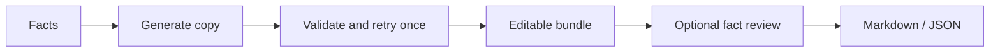

# Commerce Content Engine
Turn verified product facts into a complete, editable commerce copy bundle.

- Write a product page with FAQ, ad copy, hashtags, a shorts script and thumbnail text.
- Check claims against your facts with Fact Guard, or compare short ads in a tournament.
- Export Markdown or JSON; calculate margin from your own prices and costs.

[Try the Nemotron demo](https://commerce-content-engine-nemotron.vercel.app) · [Bring your own key](https://kks0488.github.io/commerce-content-engine/) · [한국어](README.ko.md)

Quick start (Node 18+, no dependencies):

```sh
npm test
node cli.mjs --demo
# Hosted branch: reproduce one production round with 3 fictional products:
QA_OUTPUT=/tmp/cce-raw QA_SET=my-gate QA_ROUND=1 node scripts/quality-gate.mjs production
NEBIUS_API_KEY="$NEBIUS_API_KEY" node cli.mjs --provider nebius --name "Steel cup" --info "500 ml; stainless steel; removable lid; hand wash" --lang English
```

Set `NEBIUS_API_KEY` in your environment for live generation. `LLM_API_KEY`, `LLM_BASE_URL` and `LLM_MODEL` support compatible providers. `--demo` uses labeled offline fixtures. `node scripts/serve.mjs` starts the web app on the hosted branch. GitHub Pages sends your own key directly from the browser to your chosen provider.



**Nemotron on Nebius**

- The hosted demo uses Nemotron Super for drafting with reasoning and factual review, through the Token Factory API with strict JSON Schema. Original Korean/English examples guide benefit framing; length, claim, completeness and caveat checks trigger one model repair. Unknowns stay in seller listing checks.
- On the hosted branch, Super reviews factual claims; the tournament gates ads before simulated buyer comparisons.
- Built during the hackathon: CLI, browser editor, Fact Guard, tournament, hosted demo and real-response regression checks. Accepted model JSON is preserved without FAQ replacement. AI review uses seller facts and still needs editorial judgment.

MIT © 2026 Kyoungsoo Kim. See [LICENSE](LICENSE).
